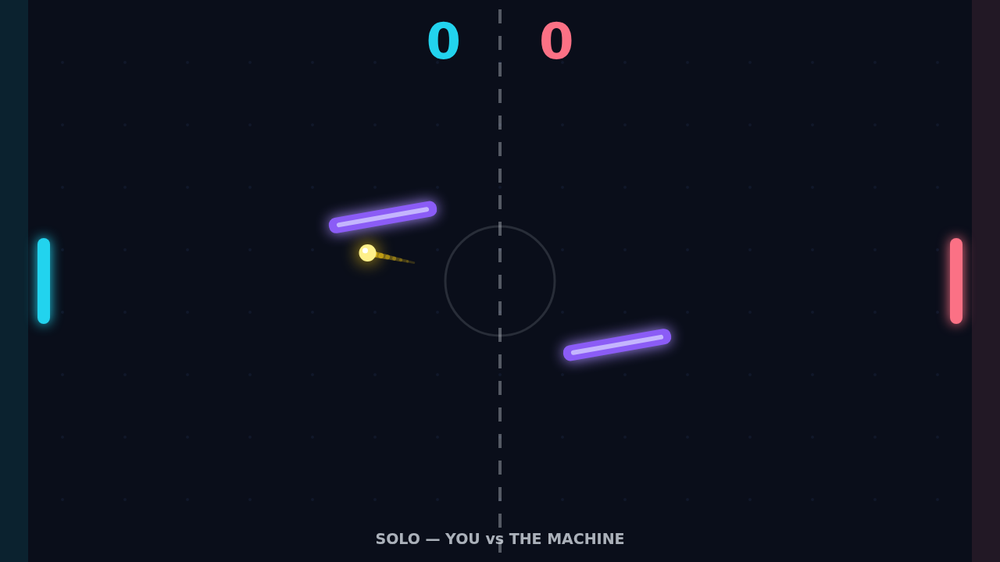
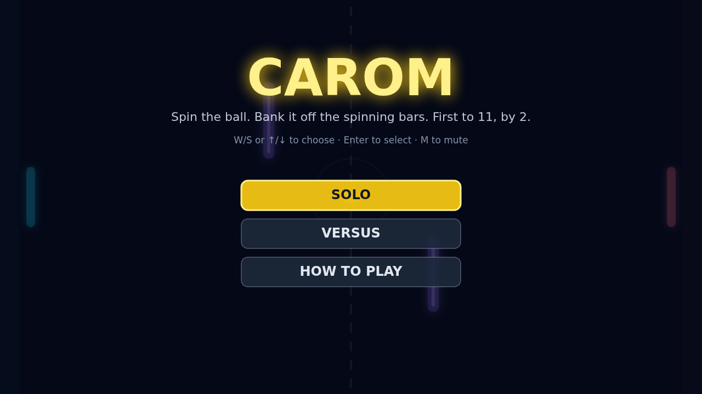

Carom is a top-down paddle duel played on a dark, glowing field. You guard the left edge, your opponent guards the right, and a single golden ball ricochets between you — off the top and bottom walls, off your paddles, and off the two violet bars that sway and spin in the middle of the field. Send the ball past the far edge to score; the first player to eleven points, ahead by at least two, takes the match.

Every rally starts with a short hold and a serve toward the player who was just scored on, then the pace only grows: each paddle hit makes the ball a little faster. Where you meet the ball on your paddle sets its angle, from a flat drive at the centre to a sharp shot off the edge — and the two mid-field bars keep bending those angles, drifting up and down in opposition while they rotate, so the gap you threaded a moment ago has already moved.

Spin is what turns a rally into a duel. Strike the ball while your paddle is moving and the ball picks up your motion as spin, curving through the air like a bending free kick before the spin fades. Feather a slow ball past the spinning bars, or whip a fast one off a tilted violet face and watch it bank around your opponent — in Solo you face a machine that reads the ball's flight, and in Versus a friend across the same keyboard does.

